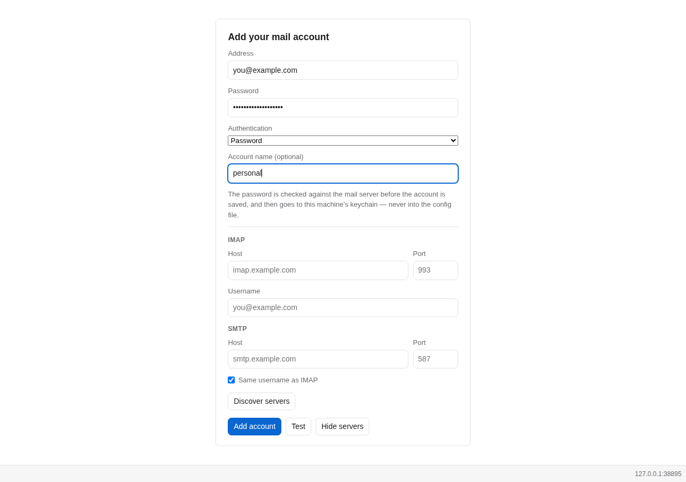
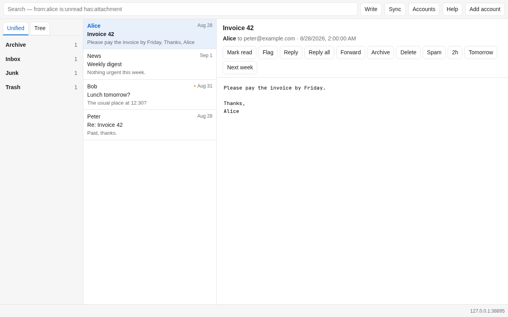
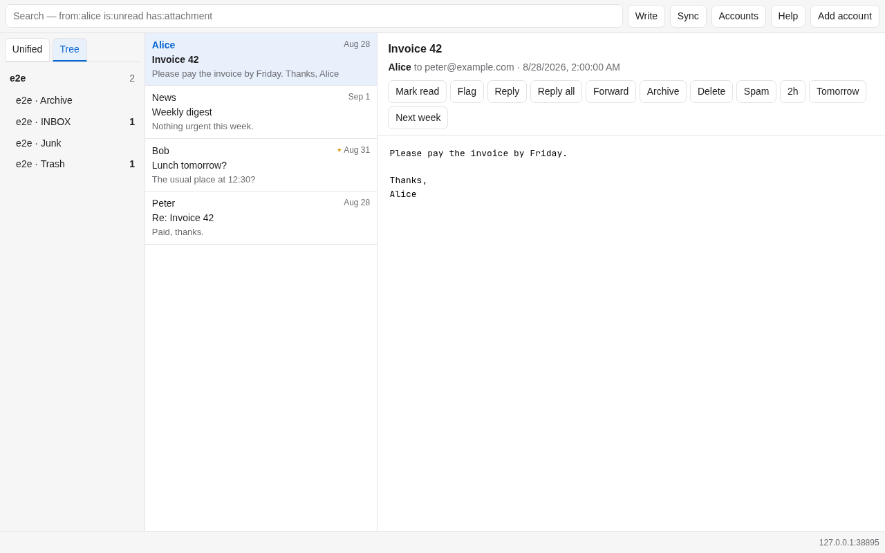
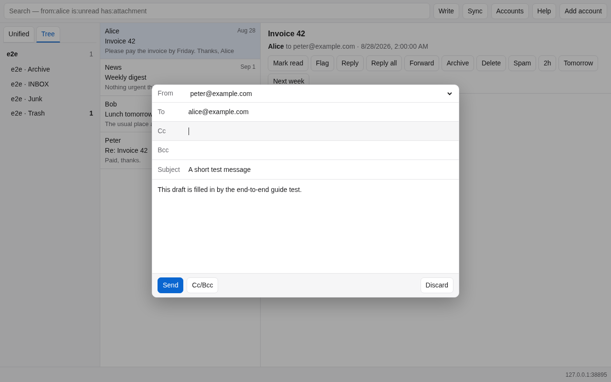
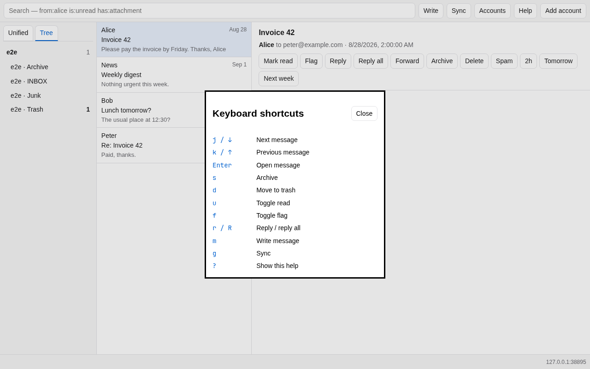

# Mailbox: the short user guide

Mailbox is an email client for an existing IMAP account. The desktop window
and browser version have the same controls; the terminal versions use the same
mail store underneath.

## Add an account

Start `mailbox gui`, or run `mailbox serve` and open the URL it prints. On a
new installation you get the account form.



Enter the address and password. Mailbox fills in known providers. For anything
else, enter the IMAP and SMTP servers; **Test** checks the login without saving
it, while **Add account** checks it and then saves the account. Provider app
passwords go in the Password field. Google, Microsoft, and Yahoo can use the
OAuth option if the build has a client ID configured.

The password goes to the OS keychain when one is available, not to
`config.toml`. On a headless machine, the less magical version is often nicer:

```sh
mailbox accounts add you@example.org \
  --credential-command 'pass show mail/personal'
mailbox sync
```

## Read mail and move around

The left side is folders, the middle is the message list, and the right side is
the open message. Click a row to read it. A message is marked read after it has
been open briefly, rather than while you are merely moving through the list.



Use the search box for ordinary text or filters such as `from:alice`,
`is:unread`, `has:attachment`, and `in:archive`. **Unified** groups equivalent
folders across accounts. **Tree** shows the actual server folders under each
account.



On a narrow screen only one pane is shown. The back arrow walks from the reader
to the list and then to folders.

The action row above a message has the unsurprising operations: mark read or
unread, flag, reply, archive, delete, spam, and snooze. Archive, delete, and
spam move the message to the server folder carrying that role; if a server has
several, choose one with `mailbox folders prefer`.

## Write mail

Press **Write** (or `m`), fill in the draft, and press **Send**. **Cc/Bcc** keeps
the less-used fields out of the way.



Send first puts the finished message in the local outbox. A sync submits it by
SMTP and files the Sent copy. This means a network failure leaves something
retryable instead of eating the draft. The status line says *queued* for this
reason. `Ctrl+Enter` sends; `Escape` closes the compose window.

## Useful keys

Press `?` or **Help** for the complete small list.



The ones worth remembering are `j`/`k` to move, `u` to toggle read, `s` to
archive, `d` to trash, `r` to reply, `m` to write, `/` to search, and `g` to
sync. There is no single-key spam shortcut; use **Spam** in the message action
row. Keys do nothing while you are typing in a field, which saves a surprising
amount of grief.

Downloaded mail remains readable offline. Run `mailbox sync --full` if you want
all bodies and attachments cached rather than recent and opened mail only.

The screenshots and the actions described here are exercised by
`tests/e2e/mailbox-e2e check guide`; see the [e2e README](../tests/e2e/README.md).
